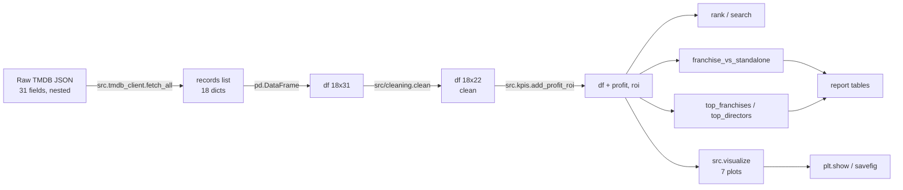

# Matplotlib, Pandas & Pipeline Walkthrough — TMDB Movie Analysis

Companion documentation for code review. Covers how matplotlib and pandas are used in
this lab, plus an end-to-end walkthrough of one movie from raw TMDB JSON to a chart.

---

# Part 1 — Matplotlib

## 1. The one import and the one pattern

```python
import matplotlib.pyplot as plt
```

Every chart in `src/visualize.py` follows the same 4-step pattern:

```python
fig, ax = plt.subplots()          # 1. create a figure + axes
ax.scatter(...) / ax.bar(...)     # 2. draw onto the axes
ax.set_xlabel(...); ax.set_ylabel(...); ax.set_title(...)  # 3. label
return ax                          # 4. hand the axes back
```

This is the **object-oriented (OO) style**: you talk to the `ax` object instead of calling
global `plt.*` functions. The lab uses this style so the plot function stays reusable —
the caller decides how to display it (notebook shows it, report saves it).

## 2. What `fig, ax = plt.subplots()` does

- `fig` = the whole canvas (the image). Mostly ignored here.
- `ax` = one set of axes (the box with x/y scales). All drawing goes through `ax`.
- `plt.subplots()` with no args makes a single 640×480 figure with one axes — that is why
  notebook output says `<Figure size 640x480 with 1 Axes>`.

## 3. The seven plot functions

| Function | Chart type | Matplotlib call | Question it answers |
|---|---|---|---|
| `plot_revenue_vs_budget` | scatter | `ax.scatter(budget_musd, revenue_musd)` | Do costly films earn more? |
| `plot_roi_by_genre` | bar | `ax.bar(labels, values)` | Which genre pays best? (mean ROI per genre, sorted) |
| `plot_popularity_vs_rating` | scatter | `ax.scatter(popularity, vote_average)` | Are popular films well rated? |
| `plot_yearly_box_office` | line | `ax.plot(years, vals)` | Mean revenue per release year |
| `plot_franchise_vs_standalone` | bar | `ax.bar(labels, vals)` | Franchise vs standalone mean revenue |
| `plot_distribution(df, column)` | histogram | `ax.hist(values)`, `ax.axvline(median)` | EDA: what is the shape of this column? |
| `plot_boxplot(df, column)` | boxplot | `ax.boxplot(values, vert=False)` | EDA: which points are genuine outliers? |

Scatter = two numeric columns, one point per film. Bar = one bar per category, height = a number.
Line = ordered x (year) with a value per point.
Histogram = one numeric column bucketed, count per bucket; the median lands as a dashed line.
Boxplot = median, quartiles, whiskers, and fliers (the outlier dots) for one column.

## 4. The genre chart's extra matplotlib detail

```python
plt.xticks(rotation=45)
```

This is the one place the lab uses the pyplot state interface instead of `ax`. It rotates
the long genre labels so they do not overlap. (Cleaner OO form would be
`ax.tick_params(axis="x", rotation=45)`.) Labels are also built with a newline:
`f"{genre}\n(n={count})"` so the film count sits under the name.

## 5. Why `return ax` (the key design point)

The function does not show or save the figure. It only builds it and returns the axes.
The caller handles display:

- Notebook (`analysis.ipynb`): calls the function, then `plt.show()` to render inline;
  `plt.tight_layout()` before show on the genre chart to fix spacing.
- Report (per `docs/CODE_REVIEW.md`): would call `plt.savefig(path)` then `doc.add_picture`.
  Because there is no screen on the build machine, the report uses the **`Agg`** backend
  (`matplotlib.use("Agg")`) — a non-interactive backend that renders to a file without a
  display. This machine's default backend here is `tkagg` (interactive), which is why
  `plt.show()` works in the notebook.

So the same seven functions serve both notebook and report — "the report can never drift
from the notebook."

## 6. Things a reviewer may ask (with answers)

- **"Why `fig, ax` instead of `plt.scatter(...)`?"**  
  OO style keeps the function pure (no global state), returns something testable/inspectable,
  and separates building from displaying. The pyplot state-machine (`plt.scatter`) mutates a
  hidden current axes, which is error-prone in scripts.

- **"Why no `plt.close()`?"**  
  In a notebook each cell renders and clears; for 18 rows it is fine. In a batch report you
  would add `plt.close(fig)` after `savefig` to free memory — a fair improvement to mention.

- **"Why bar of means for genre not boxplot?"**  
  Simple to explain and works for 18 rows. A boxplot would show spread but is harder to read
  with n=1 or 2 per genre.

- **"What does `plt.tight_layout()` do?"**  
  Adjusts subplot margins so labels/titles are not clipped. Used on the genre chart because
  the rotated labels are long.

- **"Why `ax.set_xlabel` and not `ax.xlabel`?"**  
  Matplotlib's API: setters are `set_*`, getters are `get_*`. All three (xlabel, ylabel,
  title) follow that.

- **"Can you change a label live?"**  
  Yes — edit the string in `set_xlabel`/`set_title` and rerun the cell. That is the live
  task in the review.

## 7. Quick glossary

- `plt.subplots()` → make a figure + axes.
- `ax.scatter(x, y)` → points.
- `ax.bar(labels, values)` → bars.
- `ax.plot(x, y)` → line.
- `ax.set_xlabel/ylabel/title` → annotate.
- `plt.xticks(rotation=45)` → rotate tick labels.
- `plt.tight_layout()` → fix spacing.
- `plt.show()` → display (notebook).
- `plt.savefig(path)` → write to file (report, with Agg backend).
- `return ax` → hand back the axes; caller decides show vs save.

## 8. One honest caveat

The `plt.xticks(rotation=45)` call operates on the current axes implicitly. Since each
function returns its own `ax` and the notebook calls them one at a time, it works — but it
is the one spot that breaks the pure-OO style. If asked, that is the thing I would refactor
to `ax.tick_params(axis="x", rotation=45)`.

---

# Part 2 — Pandas

## 1. Core idea

Pandas = "Excel for Python". The main object is a **DataFrame** = a table (rows × columns),
built from a list of dicts or a CSV. Columns are **Series** (1D). Everything in this lab is
about transforming a messy API response into a clean 18×22 table, then computing KPIs.

## 2. Construction & shape

```python
df_raw = pd.DataFrame(records)      # list of dicts -> table (src/main.py)
df.shape                            # (rows, cols)  e.g. (18, 22)
df.head(3)                          # first 3 rows
df.columns                          # column names
df["title"].tolist()                # one column as a list
```

- `df.copy()` is the first line of every helper so the original is never mutated.
- Naming: the pipeline chain reads `df_raw` → `df_cleaned` → `df_enriched`; inside the
  cleaning helpers the working copy carries a step-specific name instead of df2,
  e.g. `df_dropped`, `df_flattened`, `df_typed`, `df_sane`, `df_released`, `df_ordered`,
  and kpis uses `df_ranked`, `df_matches`, `df_labeled`, `df_summary`.
  The name says the state, not a number.

## 3. Selecting data

```python
df["budget"]                       # one column (Series)
df[["title", "profit"]]            # several columns
df.iloc[i]                         # row by position (used in loops)
df.iloc[i, j]                      # cell by position
df.loc[mask, "col"] = value        # set cells where mask is True
df[mask]                           # keep rows where mask is True (boolean filter)
```

- `df_cleaned = df_cleaned[df_cleaned["status"] == "Released"]` keeps only Released rows.
- `df_cleaned = df_cleaned[df_cleaned["director"] == name]` filters by director.

## 4. Cleaning toolbox (`src/cleaning.py`)

**Drop columns**
```python
del df_cleaned[col]                       # in-place column drop
df_cleaned = df_cleaned[FINAL_COLUMNS]           # keep only these columns, in this order
```

**Type conversion**
```python
pd.to_numeric(col, errors="coerce")   # bad text -> NaN, never crashes
pd.to_datetime(col, errors="coerce")  # bad date -> NaT
```
`errors="coerce"` is the safety net: garbage becomes NaN instead of raising.

**Missing values**
```python
pd.isna(v) / pd.notna(v)           # test empty
df_cleaned[col].replace(0, float("nan"))  # 0 means "unknown" here, not zero
df_cleaned[col].replace("No Data", float("nan"))
df_cleaned[col].replace("", float("nan"))
df_cleaned.loc[no_votes, "vote_average"] = nan   # via .loc, NOT chained .iloc
```
Key gotcha the lab hit: `df["vote_average"].iloc[i] = nan` (chained assignment) is
**silently dropped by pandas 3**. Fixed to `df.loc[mask, "vote_average"] = nan`. Test
`test_vote_count_zero_clears_the_rating` locks it.

**Dedup & null handling**
```python
df_cleaned.drop_duplicates(subset=["id", "title"])   # subset, because cast is a list (unhashable)
df_cleaned.dropna(subset=["id", "title"])            # drop rows missing id/title
df_cleaned.dropna(thresh=10)                         # keep rows with >=10 non-null values
```

**Reset index**
```python
df_cleaned.reset_index(drop=True)   # renumber 0,1,2,... after filtering
```

## 5. Dict/list → pipe-joined text (the cleaning trick)

API returns nested JSON. The lab flattens with plain for loops:

```python
def join_names(items, key):
    if isinstance(items, list):
        names = []
        for d in items:
            if isinstance(d, dict) and key in d:
                names.append(d[key])
            elif isinstance(d, str):
                names.append(d)
        if len(names) == 0:
            return None
        s = names[0]
        for n in names[1:]:
            s = s + "|" + n
        return s
    return items
```

Result: `genres` becomes `"Action|Science Fiction"`. Why pipe and not comma? So a genre name
can contain a comma safely, and `split("|")` recovers the list.

`belongs_to_collection` is a dict or None → `get_collection_name` returns `value.get("name")`
or None.

## 6. KPIs (`src/kpis.py`)

**New columns from arithmetic**
```python
df_enriched["profit"] = df_cleaned["revenue_musd"] - df_cleaned["budget_musd"]
df_enriched["roi"]    = df_cleaned["revenue_musd"] / df_cleaned["budget_musd"]
```
Columns support vectorized math — no loops needed (though the lab loops elsewhere for
explainability).

**Ranking**
```python
def rank(df, col, n=5, ascending=False):
    df_cleaned = df.sort_values(by=col, ascending=ascending)
    return df_cleaned.head(n)
```
`ascending=True` → smallest first. 10 ranks in the report: revenue, budget, profit high/low,
roi high/low (budget≥10), votes, rating high/low (votes≥10), popularity.

**Filtering with a boolean list (search)**
```python
keep = []
for i in range(len(df_cleaned)):
    row = df_cleaned.iloc[i]
    if "Science Fiction" in str(row["genres"]) and "Bruce Willis" in str(row["cast"]):
        keep.append(True)
    else:
        keep.append(False)
df_cleaned = df_cleaned[keep]                       # boolean indexing
df_cleaned = df_cleaned.sort_values(by="vote_average", ascending=False)
```
Why `str(row[...])`? Works on lists and NaN without crashing; `in` does substring match, no regex.

**Groupby + aggregation**
```python
g = df_cleaned.groupby("group")            # "franchise" vs "standalone"
out = pd.DataFrame({
    "movies": g.size(),
    "mean_revenue": g["revenue_musd"].mean(),
    "median_roi":   g["roi"].median(),   # median, NOT mean (one big film moves mean)
    "mean_budget":  g["budget_musd"].mean(),
    "mean_popularity": g["popularity"].mean(),
    "mean_rating": g["vote_average"].mean(),
})
```
Lab rule: revenue/budget/popularity/rating → **mean**; roi → **median**. Mean franchise ROI
≈ 8.02, median ≈ 7.84. Saying "mean roi" in the franchise table is wrong.

**Unique names via loop + per-group stats**
```python
names = []
for v in df_cleaned["belongs_to_collection"]:
    if v not in names:
        names.append(v)
for name in names:
    part = df_cleaned[df_cleaned["belongs_to_collection"] == name]
    rows.append({"franchise": name, "movies": len(part),
                 "total_revenue": part["revenue_musd"].sum(), ...})
out = pd.DataFrame(rows).sort_values(by="total_revenue", ascending=False)
```
Same pattern for `top_directors`. This is the "groupby by hand" the lab prefers for explainability.

**value_counts for sanity checks**
```python
df[col].value_counts(dropna=False).head(10)
```
Run on the six built columns before trusting them — catches typos like "Sci Fi". `inspect_anomalies`
in `cleaning.py` does exactly this; the report runs it in `main()`.

## 7. Useful small things

- `len(df)` → row count.
- `df["title"].head(3).tolist()` → first 3 titles as list.
- `.sum()`, `.mean()`, `.median()`, `.size()`.
- `pd.to_datetime(df["release_date"]).dt.year` → extract year (used in yearly chart).
- `df.copy()` always before mutating.
- `str(x)` to make `in` safe on NaN/lists.

## 8. Tests & helpers (`tests/helpers.py`)

- `fake_movies()` builds 6 records in API shape (franchise/standalone, 3 directors, zero-votes movie).
- `fake_df()` always fakes (use when asserting numbers). `done_df()` uses real backup if present.
- Why 6 not 2: each group needs an ROI outlier so mean ≠ median, otherwise the median test proves
  nothing. Franchise ROIs: 3.0, 3.0, 19.0; standalone: 2.0, 1.0, 40.0.

## 9. Reviewer live tasks & gotchas

- "Clean a 2-row DataFrame, show before/after columns" → walk `clean()` steps.
- "Rank top 3 revenue, compute median ROI by hand" → `rank(df, "revenue_musd", 3)` then groupby median.
- "Why `subset=` in drop_duplicates?" → cast is a list → unhashable → full dup check crashes.
- "Why 0 → NaN?" → 0 means unknown in this dataset.
- "Why median not mean for ROI?" → one big film moves the mean.
- "Why chained assignment failed?" → pandas 3 drops it; use `.loc[mask, col]`.
- "Why `errors='coerce'`?" → bad data becomes NaN, no crash.
- "For 1M rows?" → replace loops with vector ops (`str.contains`, `explode`, `groupby`).

## 10. One-line summary per file

- `src/tmdb_client.py` → fetch + parse JSON into records.
- `src/cleaning.py` → records → clean 18×22 DataFrame.
- `src/kpis.py` → clean df → profit/roi + 10 ranks + searches + group tables.
- `src/visualize.py` → df → 5 matplotlib axes.
- `src/main.py` → glue: fetch → clean → profit → print.
- `tests/helpers.py` → fake records so tests run offline.

---

# Part 3 — Pipeline walkthrough (one movie, JSON → chart)

Sample movie: **Avengers: Endgame** (TMDB id 299534).

## 0. Raw API response (prettified, trimmed)

TMDB needs two calls per movie (`src/tmdb_client.py` `fetch_movie`): `/movie/{id}` and
`/movie/{id}/credits`. The client merges the credits-derived fields (`cast`, `cast_size`,
`director`, `crew_size`) into the movie dict. The stored record looks like this:

```json
{
  "adult": false,
  "belongs_to_collection": { "id": 86311, "name": "The Avengers Collection" },
  "budget": 356000000,
  "genres": [
    { "id": 12, "name": "Adventure" },
    { "id": 878, "name": "Science Fiction" },
    { "id": 28, "name": "Action" }
  ],
  "homepage": "https://www.marvel.com/movies/avengers-endgame",
  "id": 299534,
  "imdb_id": "tt4154796",
  "original_language": "en",
  "original_title": "Avengers: Endgame",
  "overview": "After the devastating events of Avengers: Infinity War, ...",
  "popularity": 96.8577,
  "poster_path": "/bR8ISy1O9XQxqiy0fQFw2BX72RQ.jpg",
  "production_companies": [ { "id": 420, "name": "Marvel Studios" } ],
  "production_countries": [ { "iso_3166_1": "US", "name": "United States of America" } ],
  "release_date": "2019-04-24",
  "revenue": 2927449455,
  "runtime": 181,
  "spoken_languages": [
    { "english_name": "English", "iso_639_1": "en", "name": "English" },
    { "english_name": "Japanese", "iso_639_1": "ja", "name": "日本語" }
  ],
  "status": "Released",
  "tagline": "Avenge the fallen.",
  "title": "Avengers: Endgame",
  "video": false,
  "vote_average": 8.2,
  "vote_count": 28977,
  "cast": [ "Robert Downey Jr.", "Chris Evans", "Mark Ruffalo", "..." ],
  "cast_size": 103,
  "director": "Anthony Russo",
  "crew_size": 613
}
```

18 of these records are collected into `data/tmdb_backup.json` (gitignored).

## Pipeline overview



## Stage 1 — Fetch (`src/tmdb_client.py`)

- `fetch_all()` reads `TMDB_API_KEY` from `.env`. No key → loads `data/tmdb_backup.json`.
- For each id: `requests.get(/movie/{id})`. id `0` returns 404 → skipped. 18 left.
- Then `/movie/{id}/credits`: loops `cast` to collect `name`s; loops `crew` for `job == "Director"`.
- `time.sleep(0.25)` between calls (rate limit ~40/s).

Output of this stage: a Python list of 18 dicts (one per movie), each ~31 keys, nested
lists/dicts.

## Stage 2 — `pd.DataFrame(records)` (`src/main.py`)

```python
df = pd.DataFrame(records)        # list of dicts -> table
print("got", len(df), "movies")   # 18
print(df["title"].head(3).tolist())
```

Result: `df.shape == (18, 31)`. Each dict key becomes a column; nested values stay as
Python objects in cells (dicts/lists). Pandas does not flatten them — that is Stage 3's job.

| id | title | budget | revenue | vote_count | vote_average | genres (raw) | belongs_to_collection (raw) |
|---|---|---|---|---|---|---|---|
| 299534 | Avengers: Endgame | 356000000 | 2927449455 | 28977 | 8.2 | `[{"id":12,"name":"Adventure"},...]` | `{"id":86311,"name":"The Avengers Collection",...}` |
| 19995 | Avatar | 237000000 | 2923706026 | 34826 | 7.6 | `[{"id":878,"name":"Science Fiction"},...]` | `{"id":877268,"name":"Avatar Collection",...}` |

## Stage 3 — Cleaning (`src/cleaning.py`, `clean()`)

Each step is a pure function that returns a copy (`df_cleaned = df.copy()`).

### 3.1 `drop_irrelevant_columns` — drop 5 cols
Removes `adult, imdb_id, original_title, video, homepage`. `18×31 → 18×26`. Code:
`del df_cleaned[col]` inside a loop over `DROP_COLUMNS`.

### 3.2 `extract_collection_name` — dict → text
```python
def get_collection_name(value):
    if isinstance(value, dict):
        return value.get("name")   # "The Avengers Collection"
    return None
```
`belongs_to_collection` becomes `"The Avengers Collection"` or `None` (→ NaN later).

### 3.3 `pipe_join_names` — list of dicts → `"A|B|C"`
Applied to `genres, spoken_languages, production_countries, production_companies, cast`.
Example genres: `["Adventure","Science Fiction","Action"]` → `"Adventure|Science Fiction|Action"`.

### 3.4 `convert_dtypes` — strings/objects → numbers/dates
```python
df_cleaned["budget"] = pd.to_numeric(df_cleaned["budget"], errors="coerce")   # bad text -> NaN
df_cleaned["release_date"] = pd.to_datetime(df_cleaned["release_date"], errors="coerce")
```
After: `budget` is int64, `release_date` is datetime64.

### 3.5 `clean_unrealistic_values`
- `0 → NaN` for `budget, revenue, runtime` (0 means "unknown", not zero).
- `budget_musd = budget / 1_000_000`, `revenue_musd = revenue / 1_000_000`.
- `vote_average → NaN` where `vote_count == 0` (uses `df.loc[mask, "vote_average"] = nan`).
- `"No Data"` and `"" → NaN` for `overview, tagline`.

Endgame: `budget_musd = 356.0`, `revenue_musd = 2927.449455`.

### 3.6 `filter_released_and_dedup`
```python
df_cleaned = df_cleaned[df_cleaned["status"] == "Released"]   # keep Released only
del df_cleaned["status"]
df_cleaned = df_cleaned.drop_duplicates(subset=["id", "title"])  # subset: cast is a list (unhashable)
df_cleaned = df_cleaned.dropna(subset=["id", "title"])
df_cleaned = df_cleaned.dropna(thresh=10)              # keep rows with >=10 non-null
```

### 3.7 `reorder_and_reset`
```python
df_cleaned = df_cleaned[FINAL_COLUMNS].copy()   # 22 cols in lab order
df_cleaned = df_cleaned.reset_index(drop=True)  # renumber 0..17
```

### End of Stage 3 — clean table (Endgame row)

| id | title | release_date | genres | belongs_to_collection | budget_musd | revenue_musd | vote_count | vote_average | popularity | runtime | cast | cast_size | director | crew_size |
|---|---|---|---|---|---|---|---|---|---|---|---|---|---|---|
| 299534 | Avengers: Endgame | 2019-04-24 | Adventure\|Science Fiction\|Action | The Avengers Collection | 356.0 | 2927.449455 | 28977 | 8.2 | 96.8577 | 181 | Robert Downey Jr.\|Chris Evans\|... | 103 | Anthony Russo | 613 |

`shape == (18, 22)`. `list(df.columns) == FINAL_COLUMNS`.

## Stage 4 — KPIs (`src/kpis.py`)

### 4.1 `add_profit_roi`
```python
df_enriched["profit"] = df_cleaned["revenue_musd"] - df_cleaned["budget_musd"]   # 2927.45 - 356 = 2571.45
df_enriched["roi"]    = df_cleaned["revenue_musd"] / df_cleaned["budget_musd"]    # 2927.45 / 356 = 8.22
```
Endgame: **profit = 2571.45 MUSD, roi = 8.22**. (Avatar: profit 2686.71, roi 12.34.)

### 4.2 Ranks (`rank`)
`sort_values(by=col, ascending=...)` + `head(n)`. 10 ranks: revenue, budget, profit high/low,
roi high/low (budget≥10), votes, rating high/low (votes≥10), popularity.

### 4.3 Searches
- `search_willis_scifi_action`: keeps rows where `"Science Fiction" in genres AND "Action" in genres AND "Bruce Willis" in cast`; sorts by `vote_average` desc. → **0 rows** on this dataset (not a bug).
- `search_thurman_tarantino`: `"Uma Thurman" in cast AND director == "Quentin Tarantino"`; sorts by `runtime` asc. → **0 rows**.

### 4.4 `franchise_vs_standalone`
Labels each row `"franchise"` if collection not null else `"standalone"`, then `groupby("group")`:
- revenue, budget, popularity, rating → **mean**
- roi → **median** (one big film moves the mean)

| group | movies | mean_revenue | median_roi | mean_budget | mean_popularity | mean_rating |
|---|---|---|---|---|---|---|
| franchise | 16 | 1690.78 | 7.84 | 218.0 | 41.90 | 7.38 |
| standalone | 2 | 1765.14 | 9.62 | 180.0 | 42.34 | 7.45 |

### 4.5 `top_franchises` / `top_directors`
Get unique names via loop, filter table per name, aggregate with `len/sum/mean`, build a new
DataFrame, sort by `total_revenue` desc.

| franchise | movies | total_revenue | mean_revenue | mean_rating |
|---|---|---|---|---|
| The Avengers Collection | 4 | 7904.08 | 1976.02 | 7.96 |
| Star Wars Collection | 2 | 3402.63 | 1701.32 | 6.95 |

| director | movies | total_revenue | mean_rating |
|---|---|---|---|
| James Cameron | 2 | 5187.87 | 7.75 |
| Anthony Russo | 1 | 2927.45 | 8.20 |

## Stage 5 — Visualization (`src/visualize.py`)

Every function follows the same 4-step pattern and returns `ax`:

```python
fig, ax = plt.subplots()            # 1. canvas + axes
ax.scatter(df["budget_musd"], df["revenue_musd"])   # 2. draw
ax.set_xlabel("budget (musd)"); ax.set_ylabel("revenue (musd)")
ax.set_title("revenue vs budget")   # 3. label
return ax                           # 4. hand back
```

| Function | Type | Columns used | Question |
|---|---|---|---|
| `plot_revenue_vs_budget` | scatter | budget_musd × revenue_musd | Do costly films earn more? |
| `plot_roi_by_genre` | bar | genres (split on `\|`), mean roi per genre, `n=` on tick | Which genre pays best? |
| `plot_popularity_vs_rating` | scatter | popularity × vote_average | Are popular films well rated? |
| `plot_yearly_box_office` | line | year = `pd.to_datetime(release_date).dt.year`, mean revenue per year | Trend over time |
| `plot_franchise_vs_standalone` | bar | group × mean revenue | Franchise vs standalone |
| `plot_distribution` | histogram | one numeric column, bins, median line | EDA: shape/skew of a column |
| `plot_boxplot` | boxplot | one numeric column | EDA: which points are outliers |

Genre chart extra: `plt.xticks(rotation=45)` to stop long labels overlapping;
`plt.tight_layout()` in the notebook cell and in the report's `save_fig`, otherwise the
rotated labels get clipped in the saved png.

`plot_boxplot` deliberately does not pass `tick_labels`: that argument only exists from
matplotlib 3.9 and `requirements.txt` allows 3.8. The y tick is hidden instead, and the
column name is the x label.

The notebook also has an EDA section between cleaning and KPIs that calls
`describe()` on the numeric columns, the five `plot_distribution` histograms and the three
`plot_boxplot` views, then writes the findings as markdown under the charts.

## Stage 6 — Display (notebook vs report)

- **Notebook** (`analysis.ipynb`): calls the plot function, then `plt.show()` to render inline;
  `plt.tight_layout()` before show on the genre chart. Backend here is `tkagg` (interactive).
- **Report** (described in `docs/CODE_REVIEW.md`): `matplotlib.use("Agg")` (headless, no display)
  → `plt.savefig(path)` → `doc.add_picture`. Same seven functions, so the report cannot drift
  from the notebook.

## One-row end-to-end summary

```
raw JSON (31 nested fields)
  → fetch_all() merges credits
  → pd.DataFrame (18×31)
  → clean()  [drop cols → extract collection → pipe-join → dtypes → 0→NaN + musd → filter/dedup → reorder]  (18×22)
  → add_profit_roi()  (+ profit, roi)
  → rank / groupby / searches
  → visualize() returns ax
  → plt.show()  (notebook)  or  savefig + add_picture  (report, Agg backend)
```

That is the whole pipeline, one movie at a time, with the code that owns each arrow.
